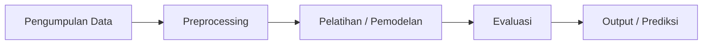

<div align="center">

# 🏙️ [JUDUL PROYEK AI ANDA]

### Solusi Kecerdasan Buatan untuk Kota dan Pemukiman yang Berkelanjutan


</div>

---

## 📑 Daftar Isi

- [Tentang Proyek](#-tentang-proyek)
- [Anggota Kelompok](#-anggota-kelompok)
- [Keterkaitan dengan SDG 11](#-keterkaitan-dengan-sdg-11)
- [Latar Belakang Masalah](#-latar-belakang-masalah)
- [Tujuan](#-tujuan)
- [Metode dan Teknologi](#-metode-dan-teknologi)
- [Arsitektur Sistem](#-arsitektur-sistem)
- [Struktur Folder](#-struktur-folder)
- [Instalasi dan Cara Menjalankan](#-instalasi-dan-cara-menjalankan)
- [Dataset](#-dataset)
- [Hasil dan Evaluasi](#-hasil-dan-evaluasi)
- [Keterbatasan](#-keterbatasan)
- [Pengembangan Selanjutnya](#-pengembangan-selanjutnya)
- [Referensi](#-referensi)

---

## 📌 Tentang Proyek

> **[Tuliskan 2–3 kalimat yang menjelaskan apa yang dilakukan sistem AI ini, siapa penggunanya, dan masalah konkret apa yang diselesaikan.]**

Proyek ini dibuat untuk memenuhi tugas mata kuliah **Kecerdasan Buatan** dengan mengangkat tema **SDG 11: Kota dan Pemukiman yang Berkelanjutan**.

---

## 👥 Anggota Kelompok

<div align="center">

### KELOMPOK 11

| No | Nama | NIM |
|:--:|------|:---:|
| 1 | **Muh. Arsyaf Nawir** | E1E125019 |
| 2 | **Muh. Fahri Fairuz Ramadhan** | E1E125056 |
| 3 | **Adinda Rizky Wulandari** | E1E125070 |

</div>

**Pembagian peran** *(sesuaikan dengan kontribusi sebenarnya)*:

| Nama | Kontribusi |
|------|-----------|
| Muh. Arsyaf Nawir | [contoh: pengumpulan data & preprocessing] |
| Muh. Fahri Fairuz Ramadhan | [contoh: pembuatan dan pelatihan model] |
| Adinda Rizky Wulandari | [contoh: evaluasi, dokumentasi, dan laporan] |

---

## 🌍 Keterkaitan dengan SDG 11

**SDG 11 — Kota dan Pemukiman yang Berkelanjutan** bertujuan menjadikan kota dan permukiman inklusif, aman, tangguh, dan berkelanjutan.

Proyek ini berkontribusi pada target berikut:

| Target SDG 11 | Kaitan dengan Proyek |
|---------------|----------------------|
| `[mis. 11.2 Transportasi berkelanjutan]` | [jelaskan secara spesifik] |
| `[mis. 11.6 Dampak lingkungan kota, kualitas udara & sampah]` | [jelaskan secara spesifik] |
| `[mis. 11.5 Pengurangan dampak bencana]` | [jelaskan secara spesifik] |

> ⚠️ Pilih **satu atau dua** target yang benar-benar relevan. Mengklaim terlalu banyak target tanpa bukti justru melemahkan proyek.

---

## ❗ Latar Belakang Masalah

[Jelaskan masalah nyata yang diangkat. Gunakan data dengan sumber yang jelas (BPS, KLHK, Kementerian PUPR, WHO, atau jurnal). Jangan mencantumkan angka tanpa sumber.]

---

## 🎯 Tujuan

1. [Tujuan utama, mis. membangun model AI untuk ...]
2. [Tujuan kedua, mis. mengevaluasi akurasi model dengan metrik ...]
3. [Tujuan ketiga, mis. menyajikan hasil dalam bentuk antarmuka sederhana]

---

## 🛠️ Metode dan Teknologi

| Kategori | Detail |
|----------|--------|
| Jenis pendekatan AI | [mis. Machine Learning / Deep Learning / Search / Fuzzy / NLP] |
| Algoritma | [mis. Random Forest, CNN, A*, K-Means] |
| Bahasa | Python |
| Library | [mis. pandas, scikit-learn, TensorFlow, matplotlib] |
| Tools | [mis. Google Colab, VS Code, Git] |

---

## 🧩 Arsitektur Sistem



> Ganti diagram di atas agar sesuai dengan alur sistem Anda yang sebenarnya.

---

## 📂 Struktur Folder

```text
.
├── data/              # dataset mentah dan hasil olahan
├── notebooks/         # notebook eksperimen
├── src/               # source code utama
├── models/            # model tersimpan
├── results/           # grafik dan hasil evaluasi
├── requirements.txt
└── README.md
```

---

## 🚀 Instalasi dan Cara Menjalankan

```bash
# 1. Clone repository
git clone https://github.com/[username]/[nama-repo].git
cd [nama-repo]

# 2. (Opsional) Buat virtual environment
python -m venv venv
source venv/bin/activate      # Windows: venv\Scripts\activate

# 3. Install dependensi
pip install -r requirements.txt

# 4. Jalankan program
python src/main.py
```

---

## 📊 Dataset

| Atribut | Keterangan |
|---------|------------|
| Sumber | [nama sumber + tautan] |
| Jumlah data | [isi] |
| Fitur | [isi] |
| Label / target | [isi] |
| Lisensi | [isi] |

---

## 📈 Hasil dan Evaluasi

| Metrik | Nilai |
|--------|:-----:|
| Akurasi | [isi] |
| Precision | [isi] |
| Recall | [isi] |
| F1-Score | [isi] |

**Temuan utama:** [ringkas 2–3 poin hasil yang benar-benar didukung data].

<!-- Tambahkan gambar hasil:

-->

---

## ⚠️ Keterbatasan

Bagian ini penting untuk kredibilitas. Contoh yang perlu dipertimbangkan:

- Ukuran dan kualitas dataset
- Risiko overfitting
- Cakupan geografis data
- Asumsi yang dipakai dan belum diuji

---

## 🔭 Pengembangan Selanjutnya

- [ ] [Rencana 1]
- [ ] [Rencana 2]
- [ ] [Rencana 3]

---

## 📚 Referensi

1. United Nations. *Sustainable Development Goal 11: Make cities and human settlements inclusive, safe, resilient and sustainable.* https://sdgs.un.org/goals/goal11
2. [Tambahkan referensi lain yang benar-benar Anda gunakan]

---

<div align="center">

**Kelompok 11 · SDG 11 Kota dan Pemukiman yang Berkelanjutan**

*Dibuat untuk tugas Kecerdasan Buatan*

</div>
