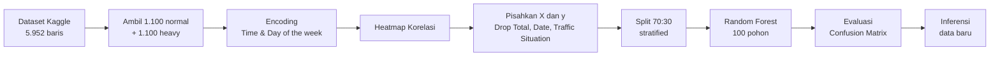

<div align="center">


# 🚦 Klasifikasi Tingkat Kemacetan Lalu Lintas

### Berdasarkan Jumlah dan Jenis Kendaraan Menggunakan Machine Learning (Random Forest)


</div>

---

## 📑 Daftar Isi

- [Tentang Proyek](#-tentang-proyek)
- [Anggota Kelompok](#-anggota-kelompok)
- [Keterkaitan dengan SDG 11](#-keterkaitan-dengan-sdg-11)
- [Latar Belakang dan Masalah](#-latar-belakang-dan-masalah)
- [Rumusan Masalah dan Tujuan](#-rumusan-masalah-dan-tujuan)
- [Dataset](#-dataset)
- [Alur Kerja](#-alur-kerja)
- [Preprocessing](#-preprocessing)
- [Pelatihan Model](#-pelatihan-model)
- [Hasil Evaluasi](#-hasil-evaluasi)
- [Inferensi (Contoh Penggunaan)](#-inferensi-contoh-penggunaan)
- [Keterbatasan](#-keterbatasan)
- [Pengembangan Selanjutnya](#-pengembangan-selanjutnya)
- [Cara Menjalankan](#-cara-menjalankan)

---

## 📌 Tentang Proyek

Proyek **Machine Learning** ini membangun model klasifikasi untuk menentukan apakah kondisi lalu lintas berada pada tingkat **Normal (lancar)** atau **Heavy (padat/macet)**, berdasarkan jumlah dan jenis kendaraan (mobil, sepeda motor, bus, truk), jam, dan hari pencatatan.

| Aspek | Keterangan |
|-------|-----------|
| Jenis tugas | Klasifikasi biner |
| Algoritma | Random Forest Classifier (100 pohon) |
| Dataset | Traffic Prediction Dataset (Kaggle) |
| Hasil utama | Akurasi **97,73%** pada 660 data uji |

---

## 👥 Anggota Kelompok

<div align="center">

### KELOMPOK 11

| No | Nama | NIM |
|:--:|------|:---:|
| 1 | **Muh. Arsyaf Nawir** | E1E125019 |
| 2 | **Muh. Fahri Fairuz Ramadhan** | E1E125056 |
| 3 | **Adinda Rizky Wulandari** | E1E125070 |

</div>

---

## 🌍 Keterkaitan dengan SDG 11

<div align="center">


*Ikon SDG © United Nations, digunakan untuk keperluan edukasi.*

</div>

**SDG 11: Kota dan Pemukiman yang Berkelanjutan.**

Proyek ini berkaitan secara tidak langsung dengan:

| Target | Kaitan |
|--------|--------|
| **11.2** Sistem transportasi yang aman, terjangkau, dan berkelanjutan | Identifikasi kondisi padat membantu rekayasa lalu lintas dan pengaturan lampu lalu lintas adaptif |
| **11.6** Mengurangi dampak lingkungan kota (termasuk kualitas udara) | Kemacetan meningkatkan konsumsi bahan bakar dan emisi kendaraan, sehingga deteksi dini dapat menjadi dasar mitigasi |

> Catatan: kontribusinya bersifat pendukung keputusan. Proyek ini belum mengukur pengurangan emisi atau waktu tempuh secara langsung.

---

## ❗ Latar Belakang dan Masalah

Kemacetan merupakan tantangan utama kota-kota besar di Indonesia. Dampaknya meliputi pemborosan waktu, naiknya konsumsi bahan bakar, dan meningkatnya emisi kendaraan. Tingkat kepadatan jalan dipengaruhi oleh volume dan komposisi kendaraan (mobil, motor, bus, truk) pada rentang waktu tertentu.

**Masalah yang diselesaikan:** petugas dan sistem pengelola lalu lintas sulit menentukan ruas jalan atau rentang waktu yang berpotensi padat hanya dari data jumlah dan jenis kendaraan. Akibatnya, rekayasa lalu lintas, pengaturan durasi lampu adaptif, dan peringatan dini menjadi lambat dan kurang tepat sasaran.

---

## 🎯 Rumusan Masalah dan Tujuan

**Rumusan masalah**

1. Bagaimana memprediksi kemacetan lalu lintas menggunakan algoritma Random Forest?
2. Faktor apa saja yang memengaruhi terjadinya kemacetan lalu lintas?
3. Seberapa akurat model Random Forest dalam memprediksi kemacetan lalu lintas?

**Tujuan**

Membangun model machine learning yang mengklasifikasikan kepadatan lalu lintas ke dalam 2 kelas berdasarkan jumlah dan jenis kendaraan.

| Kelas | Label | Arti |
|:-----:|-------|------|
| `0` | Normal | Lalu lintas lancar |
| `1` | Heavy | Lalu lintas padat/macet |

---

## 📊 Dataset

**Sumber:** *Traffic Prediction Dataset* (Kaggle). Tautan: `[tambahkan URL dataset]`

| Informasi | Nilai |
|-----------|:-----:|
| Baris data asli | 5.952 |
| Fitur input utama | 6 |
| Sampel yang dipakai | 2.200 (seimbang) |
| Kelas normal | 1.100 |
| Kelas heavy | 1.100 |

**Variabel dalam dataset**

| Variabel | Deskripsi | Peran |
|----------|-----------|-------|
| `Time` | Waktu pencatatan | Fitur |
| `Date` | Tanggal data diinputkan | Di-drop |
| `Day of the week` | Hari saat data direkam | Fitur |
| `CarCount` | Jumlah mobil | Fitur |
| `BikeCount` | Jumlah sepeda motor | Fitur |
| `BusCount` | Jumlah bus | Fitur |
| `TruckCount` | Jumlah truk | Fitur |
| `Total` | Total seluruh kendaraan | Di-drop (cegah data leakage) |
| `Traffic Situation` | Label tingkat kepadatan | Target |

**Penerapan variabel target:** hanya dua kategori bawaan dataset yang dipakai, yaitu `normal` dan `heavy`. Kategori `low` dan `high` **tidak digunakan**. Masing-masing kelas diambil 1.100 baris secara acak.

---

## 🧭 Alur Kerja



---

## 🧹 Preprocessing

### 1. Encoding data

- Kolom `Time` (format teks/jam) dikonversi menjadi variabel numerik.
- Kolom `Day of the week` di-encode dengan **one-hot encoding** (7 kolom hari).

### 2. Analisis korelasi (heatmap)

| Fitur | Korelasi dengan `Traffic Situation` | Interpretasi |
|-------|:----------------------------------:|--------------|
| `CarCount` | 0,83 | Positif kuat |
| `BusCount` | 0,69 | Positif kuat |
| `BikeCount` | 0,65 | Positif kuat |
| `TruckCount` | -0,67 | Negatif |
| `Time` | 0,07 | Lemah |
| `Day of the week` | ≈ 0 | Sangat lemah |

### 3. Pemisahan fitur (X) dan target (y)

```python
# Feature X
drop_cols = ["Total", "Date", "Traffic Situation"]
X = df.drop(columns=[c for c in drop_cols if c in df.columns]).copy()

# Target y
y = df["Traffic Situation"]
```

- **X:** 12 kolom, yaitu `Time`, `CarCount`, `BikeCount`, `BusCount`, `TruckCount`, dan 7 kolom hari hasil one-hot.
- **y:** `Traffic Situation` (0 = normal, 1 = heavy).
- Kolom `Total` di-drop untuk menghindari **data leakage** yang membuat akurasi tidak realistis (mendekati 100%).

---

## 🌲 Pelatihan Model

**Pembagian data**

| Set | Proporsi | Jumlah baris |
|-----|:--------:|:------------:|
| Train | 70% | 1.540 |
| Test | 30% | 660 |

```python
X_train, X_test, y_train, y_test = train_test_split(
    X, y, test_size=0.3, random_state=42, stratify=y
)
```

**Random Forest:** gabungan 100 pohon keputusan yang dilatih pada sampel data acak berbeda. Prediksi akhir ditentukan lewat voting seluruh pohon sehingga hasilnya lebih stabil.

```python
model = RandomForestClassifier(n_estimators=100, random_state=42)
model.fit(X_train, y_train)
```

---

## 📈 Hasil Evaluasi

<div align="center">

### Akurasi data uji: **97,73%** (645 dari 660 benar)

</div>

| Kelas | Precision | Recall | F1-Score | Support |
|-------|:---------:|:------:|:--------:|:-------:|
| normal (0) | 0,98 | 0,97 | 0,98 | 330 |
| heavy (1) | 0,97 | 0,98 | 0,98 | 330 |
| **Accuracy** | | | **0,98** | **660** |

**Confusion matrix**

| | Prediksi normal | Prediksi heavy |
|---|:---:|:---:|
| **Aktual normal** | 320 | 10 (false positive) |
| **Aktual heavy** | 5 (false negative) | 325 |

- 10 data normal salah diprediksi heavy.
- 5 data heavy salah diprediksi normal.

<!-- Tambahkan gambar jika sudah diekspor:


-->

---

## 🔮 Inferensi (Contoh Penggunaan)

Model yang sudah dilatih dipakai untuk memprediksi data baru.

| Input | Nilai |
|-------|:-----:|
| Time (jam, 0-23) | 17 |
| CarCount | 140 |
| BikeCount | 20 |
| BusCount | 40 |
| TruckCount | 50 |
| Day of the week | Monday |

**Hasil klasifikasi: `heavy`** 🔴

---

## 🚀 Cara Menjalankan

> Sesuaikan nama file dengan isi repositori kalian.

```bash
# 1. Clone repository
git clone https://github.com/[username]/[nama-repo].git
cd [nama-repo]

# 2. Install dependensi
pip install pandas numpy scikit-learn matplotlib seaborn

# 3. Letakkan dataset hasil unduhan Kaggle di folder data/

# 4. Jalankan notebook / skrip
jupyter notebook [nama-notebook].ipynb
```

---

<div align="center">

**Kelompok 11 · Proyek Machine Learning**
*SDG 11: Kota dan Pemukiman yang Berkelanjutan*

</div>
